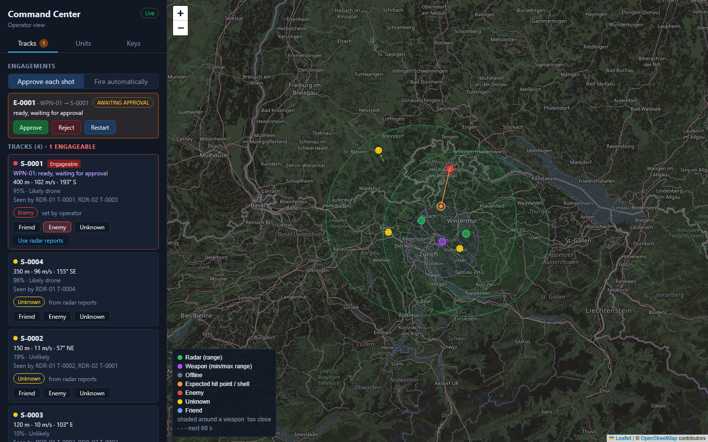
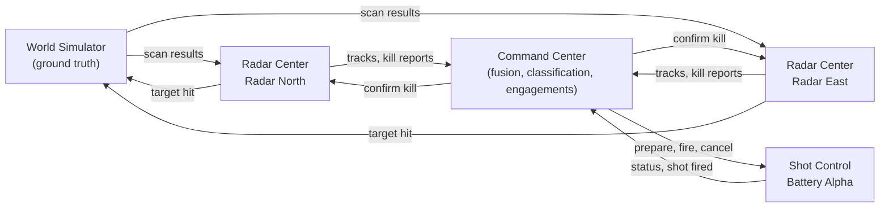
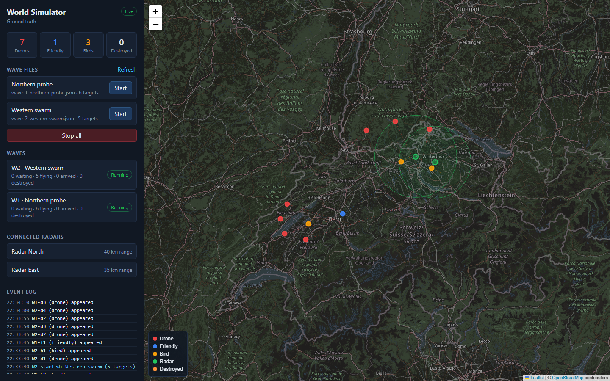
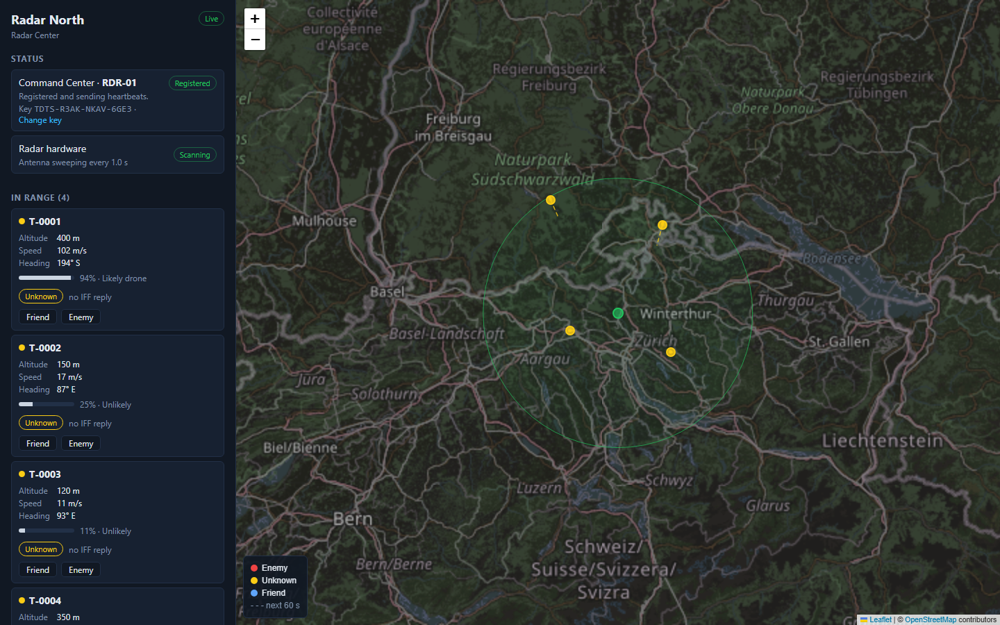
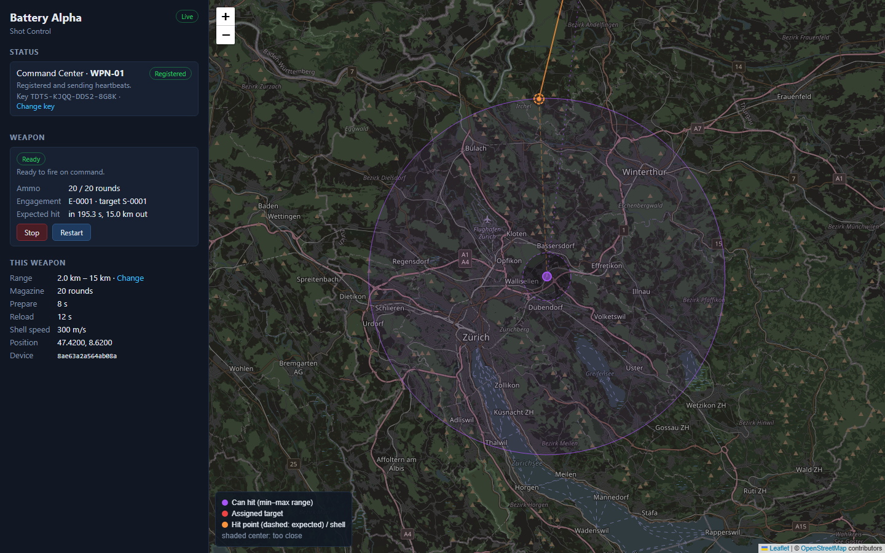

# TDTS: a networked air-defense simulation

TDTS is a real-time simulation of a small air-defense network: radars detect flying objects, a command center fuses what they see and decides what is hostile, and mortar-like weapons are told when to prepare and fire. Each part is its own program with its own operator page, and they talk to each other only over WebSockets, like separate devices on a network.

It's a demonstration of how such a system fits together, so it favors clarity over realism: every step (detection, fusion, classification, weapon assignment, firing, kill confirmation) is visible on a map and explained in plain words.



## How it works



1. **The World Simulator** knows where everything really is: drones, friendly aircraft and birds flying in straight lines, loaded from wave files. Only radars connect to it; to a radar it is simply its own antenna hardware.
2. **Each Radar Center** sweeps once a second and sees what is in its range, with noise. It turns detections into tracks (altitude, speed, heading) and estimates how likely each one is a drone. Friendly aircraft answer IFF (identification friend or foe), and the radar's operator can mark tracks friend or enemy.
3. **The Command Center** fuses the tracks of all radars into one picture of the sky and decides each track's classification: friend if any radar says friend, otherwise enemy if any radar says enemy, otherwise unknown. Its operator can override that. Enemies likely enough to be drones are engageable.
4. For each engageable enemy, the Command Center picks the free weapon that can hit it soonest and tells it to **prepare**. When the weapon is ready, it fires right away (automatic mode) or once the operator approves (approval mode). Until the shot, the operator can stop the engagement or restart the weapon's preparation.
5. **Shot Control** (the weapon) computes its own firing solution: where the target will be when the shell arrives, within its minimum and maximum range. It fires, reports the shot and reloads.
6. **Kill confirmation:** when the shell lands, the Command Center asks the radars that saw the target to confirm. Each radar tells its hardware (the World Simulator) the target was hit, checks its next sweep, and reports whether the target is gone.

Radars and weapons join the network with **registration keys** issued by the Command Center, and prove who they are with a **device key** (Ed25519 challenge-response), so a copied registration key is useless on another machine.

| World Simulator                                                                      | Radar Center                                                                                            | Shot Control                                                                                                |
| ------------------------------------------------------------------------------------ | ------------------------------------------------------------------------------------------------------- | ----------------------------------------------------------------------------------------------------------- |
|  |  |  |
| Ground truth: every object, the waves, the event log.                                | One radar: its tracks and IFF marking.                                                                  | One weapon: state, ammo, the assigned target and its firing solution.                                       |

## Running it

You need [Node.js](https://nodejs.org/) 22 or later.

```bash
npm install
npm run scenario
```

This starts the whole sample scenario in one terminal: the World Simulator, the Command Center, two radars and one weapon, each with its output prefixed by its name. When everything is up it lists the pages:

| Page            | Address               |
| --------------- | --------------------- |
| World Simulator | http://localhost:7001 |
| Command Center  | http://localhost:7101 |
| Radar North     | http://localhost:7201 |
| Radar East      | http://localhost:7202 |
| Battery Alpha   | http://localhost:7301 |

**First run only: register the units.** On a fresh checkout the radars and the weapon have no registration key yet, so their pages say "No key". For each of them:

1. In the Command Center, open the **Keys** tab, choose **Radar** or **Weapon**, keep **Automatic**, and click **Generate key**.
2. Copy the key, paste it on the unit's page, and click **Register**.

The units remember their keys (and the Command Center its units), so from then on `npm run scenario` comes up fully registered.

**Then start a wave** on the World Simulator page (**Start** next to a wave file) and watch the tracks appear on the radars and in the Command Center. Click a track on the Command Center map to classify it. Use the fire-mode switch to choose between approving each shot and firing automatically.

Ctrl+C stops everything.

## Scenarios

A scenario is a folder of JSON files; `npm run scenario -- --dir path/to/folder` runs another one.

| File                  | What it sets                                                                              |
| --------------------- | ----------------------------------------------------------------------------------------- |
| `world-sim.json`      | World Simulator ports, the waves folder, the map's starting view                          |
| `command-center.json` | Command Center ports, fire mode, drone-likelihood threshold for engaging                  |
| `radars/*.json`       | One radar each: name, position (lat/lon), range, sweep interval, noise, page port         |
| `weapons/*.json`      | One weapon each: position, min/max range, ammo, prepare and reload time, shell speed      |
| `waves/*.json`        | Targets: kind (drone, friendly, bird), start and destination, speed, altitude, spawn time |

Positions are real latitude and longitude; the sample scenario is set around Zurich.

## Simplifications

On purpose, to keep the system easy to follow:

- Targets fly in straight lines at constant speed and altitude.
- A computed shot always hits; shells are not simulated in the world. The weapon's job is to work out when and where to fire.
- The map is 2D; altitude is reported but doesn't affect detection or firing.
- Weapons have a minimum and maximum range, ammunition and reload times, but no firing arcs.
- There are no defended areas: the system protects everything in reach.

## Project layout

```
packages/shared/      protocol (zod schemas), geo math, intercept search, device keys
apps/world-sim/       World Simulator: ground truth and the radar hardware link
apps/command-center/  Command Center: registry and keys, fusion, classification, engagements
apps/radar-center/    Radar Center: tracking, drone likelihood, IFF, kill checks
apps/shot-control/    Shot Control: weapon state machine and firing solution
apps/launcher/        npm run scenario
scenario/             the sample scenario
docs/DESIGN.md        system design: architecture, protocol, decisions
```

Each program has a `DESIGN.md` describing its responsibilities, state and UI. Every program is a Node.js server (TypeScript, `ws`) that also serves its operator page (React, Leaflet with OpenStreetMap tiles) through Vite.

## Development

```bash
npm run check
```

runs type checking, ESLint, Prettier and the Vitest unit tests. The logic of each program (tracking, fusion, classification, engagement planning, the weapon's state machine, the intercept math) is plain, clock-independent code with unit tests.
